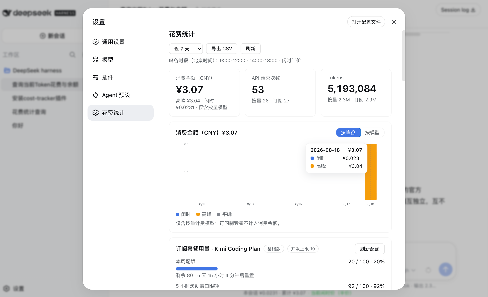
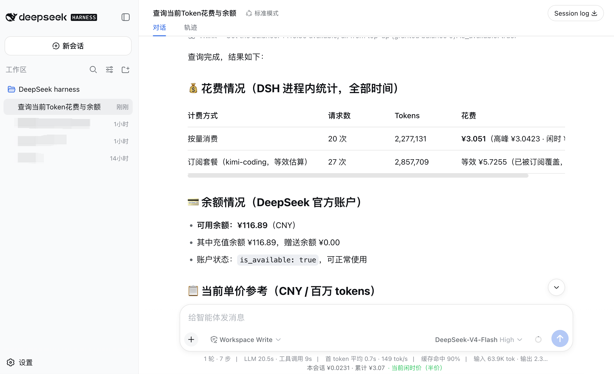
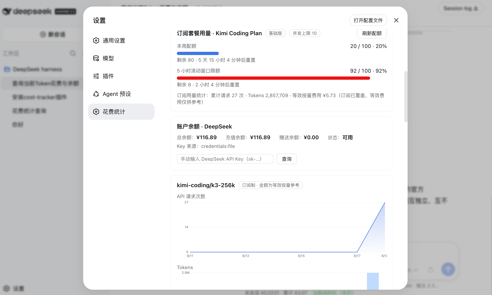
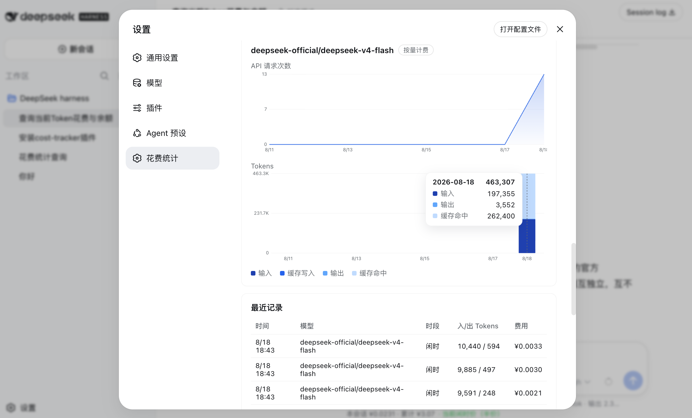

<div align="center">

#  DSH Cost Tracker

**LLM usage and cost tracking for DeepSeek Harness**

[简体中文](./README.md) · [English](./README.en.md)

[](https://www.npmjs.com/package/@angelyeye/dsh-cost-tracker)


[](https://github.com/Angelyeye/dsh-cost-tracker/stargazers)

</div>

> Track every LLM call in DSH: tokens, estimated cost, subscription usage and account balances. Explore the data in a dashboard, ask an Agent in chat, or optionally aggregate several machines through your own cloud service.

[Quick start](#quick-start) · [Screenshots](#screenshots) · [Changelog](./CHANGELOG.md)

## What you get

| Capability | What it does |
| --- | --- |
| **Automatic accounting** | Records input, output, cache tokens and request counts, grouped by day, model, device and Agent. |
| **Price matching** | Supports peak/off-peak pricing, subscription equivalents, official price sync and a multi-vendor catalog. |
| **Dashboard** | Shows overview cards, cost charts, model details and a token-usage heatmap. |
| **Plans and balances** | Tracks Kimi Coding Plan, Volcengine Coding Plan and supported account balances. |
| **Agent and API access** | Ask about cost, prices, peak periods, imports or sync status in chat, or call the local HTTP API. |
| **Multi-machine and privacy** | Stores data locally by default, with optional self-hosted sync and credentials usually managed by DSH. |

## Screenshots

<table>
  <tr>
    <td width="50%"></td>
    <td width="50%"></td>
  </tr>
  <tr>
    <td></td>
    <td></td>
  </tr>
</table>

The UI can vary with the DSH host and plugin version. These screenshots show the main information layout.

## Quick start

You need an existing `dsh web` setup. The package declares `dsh >= 0.1.0-rc.1`; if your host does not expose the plugin marketplace, use the manual installation method in the expandable section below.

### 1. Install

```bash
dsh plugin --profile web add @angelyeye/dsh-cost-tracker
```

You can also open **Settings → Plugin Marketplace** in DSH and search for `dsh-cost-tracker`.

### 2. Restart and refresh

Restart `dsh web` when prompted, then refresh the browser page.

### 3. Verify

1. Open **Settings → Cost Tracker** and confirm the dashboard is visible.
2. Confirm that the cost status bar appears below the chat input.
3. Ask the Agent, “How much did I spend today?” and verify that it returns a result.

<details>
<summary>Manual installation, development links and old package migration</summary>

Manual installation:

```bash
mkdir -p ~/.dsh/profiles/node_modules/@angelyeye
git clone https://github.com/Angelyeye/dsh-cost-tracker.git ~/.dsh/profiles/node_modules/@angelyeye/dsh-cost-tracker
```

Append this entry to the top-level array in `~/.dsh/profiles/web/cordis.patch.yml`:

```yaml
- insert:
    - id: dsh-cost-tracker
      name: "@angelyeye/dsh-cost-tracker"
```

Then restart:

```bash
dsh web
```

For development, use the official link workflow so the profile does not reinstall an older package on the next startup:

```bash
dsh plugin --profile web add link:/path/to/dsh-cost-tracker
```

When migrating from the old unscoped package `dsh-cost-tracker`, remove its loader entry and old directory before installing `@angelyeye/dsh-cost-tracker`. If the source version is **v1.7.0**, upgrade directly to **v1.7.1 or later**; reinstalling v1.7.0 does not fix its client registration defect. Usage data lives in a separate storage file and is not removed by changing the installation method.

</details>

## How it works

1. **Capture calls**: read model, token and subscription information from DSH LLM calls.
2. **Match prices**: apply provider, model, time-window, subscription and custom-catalog rules.
3. **Store and aggregate**: write local details and daily rollups by default; optionally upload idempotent batches to your own cloud service.

## Common tasks

### Dashboard

Open **Settings → Cost Tracker** to view today, month-to-date and all-time cost, request counts, tokens, balances, model details and the token heatmap. The dashboard supports **local / local + cloud / cloud only** scopes.

### Ask in chat

The plugin exposes these Agent tools:

| Tool | Example |
| --- | --- |
| `cost_stats` | “How much did I spend today?” “What is the total across all machines?” |
| `cost_prices` | “What price is being used for this model?” |
| `cost_peak` | “Is it peak or off-peak right now?” |
| `cost_recompute` | “Recheck historical records with the current pricing rules.” |
| `cost_import` | “Import usage from sessions before the plugin was installed.” |
| `cost_sync` | “Is cloud sync healthy? Sync now.” |
| `cost_reset` | “Clear all usage statistics.” |

### Export

Use **Data and display** in the settings page to export CSV files containing detail records and daily rollups for Excel, Numbers or other analysis tools.

## How data is stored

- Default data file: `~/.dsh/storages/cost-tracker-records.json`.
- Override the storage location with `DSH_HOME` or `DSH_COST_TRACKER_STORE`.
- Detailed records are retained for 180 days; older data is folded into permanent daily rollups so all-time totals remain accurate.
- Cloud sync is optional. When enabled, the plugin uploads the token, cost, timestamp and identifier fields needed for aggregation, with optional session-id masking.
- Cloud tokens and Volcengine `SecretAccessKey` values are normally stored through DSH credentials; older hosts or a read-only credential store may retain an existing configured value and report that state.
- The local HTTP API listens on loopback. Do not expose the DSH service port directly to the public internet.

<details>
<summary>Advanced configuration: peak pricing, plans, cloud sync and catalogs</summary>

Open **Settings → Cost Tracker → the gear button in the page header**.

Available settings include:

- Peak/off-peak timeline, transition reminders, system notifications and display switches.
- Kimi Coding Plan, Volcengine Coding Plan and supported subscription quotas.
- Self-hosted cloud URL, device name, shared token, sync interval, session masking and default scope.
- Official price checks, the multi-vendor catalog, exchange rates, matching mode and manual overrides.
- History import, cost recomputation, data reset and CSV export.

`docs/provider-pricing.json` contains the multi-vendor catalog shipped with the package. Pricing and billing eras change over time; use the settings page and `cost_prices` for the active rules.

</details>

<details>
<summary>HTTP API</summary>

The API is local `POST` + JSON. Common endpoints include:

```text
/api/cost-tracker/summary
/api/cost-tracker/dashboard
/api/cost-tracker/usage
/api/cost-tracker/peak
/api/cost-tracker/sync
/api/cost-tracker/sync-now
/api/cost-tracker/sync-test
/api/cost-tracker/cloud
/api/cost-tracker/balance
/api/cost-tracker/prices
/api/cost-tracker/recompute
/api/cost-tracker/import-status
/api/cost-tracker/import-run
/api/cost-tracker/export
```

Example:

```bash
curl -X POST http://127.0.0.1:3080/api/cost-tracker/summary -d '{}'
```

The `3080` value above is only an example. Replace it with the port used by your `dsh web` instance.

</details>

<details>
<summary>Multi-machine aggregation</summary>

Multi-machine aggregation uses the separate self-hosted [`dsh-cost-cloud`](https://github.com/Angelyeye/dsh-cost-cloud) service; its ingest contract is documented in [`INGEST-API.md`](https://github.com/Angelyeye/dsh-cost-cloud/blob/main/docs/INGEST-API.md). The plugin works without it for local tracking; once configured, several devices can share local, local-plus-cloud or cloud-only views, with device and Agent breakdowns.

Configure it at **Settings → Cost Tracker → the gear button → Multi-machine aggregation (cloud sync)**.

</details>

## FAQ

<details>
<summary>Will restarting DSH lose my data?</summary>

No. Records are persisted locally and restored on startup. Temporary Windows file locks are retried automatically. If the problem persists, check that only one DSH instance is running.

</details>

<details>
<summary>Is a subscription “equivalent cost” a real charge?</summary>

No. It estimates what those calls would have cost at usage-based rates and helps evaluate a plan. The provider’s bill remains authoritative.

</details>

<details>
<summary>Why can the number differ from the provider bill?</summary>

The plugin calculates locally from its price catalog and each record timestamp. Provider price changes, tiered pricing or different billing scopes can create differences. Use the official bill for exact charges.

</details>

<details>
<summary>How do I uninstall or update?</summary>

For marketplace installs, use **Settings → Plugin Marketplace**. For manual installs, remove the `dsh-cost-tracker` loader entry and then delete the plugin directory if needed. A client-only update usually needs a hard browser refresh; host-side changes require restarting `dsh web`.

</details>

## Development

```bash
npm install
npm test
```

The test suite covers storage, pricing, plans, cloud sync, import, configuration and client rendering.

## Related files

- [`CHANGELOG.md`](./CHANGELOG.md): complete release history.
- [`docs/provider-pricing.json`](./docs/provider-pricing.json): bundled multi-vendor pricing catalog.
- [`docs/THIRD-PARTY-NOTICES.md`](./docs/THIRD-PARTY-NOTICES.md): third-party works and data sources.
- [`package.json`](./package.json): package metadata, host compatibility and scripts.

## License

[MIT](./LICENSE)
