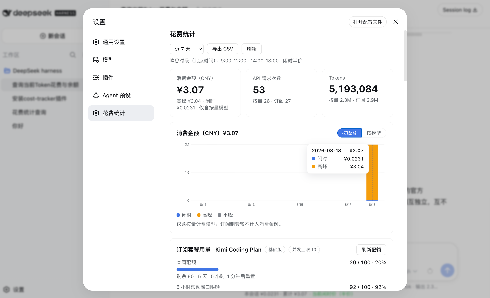
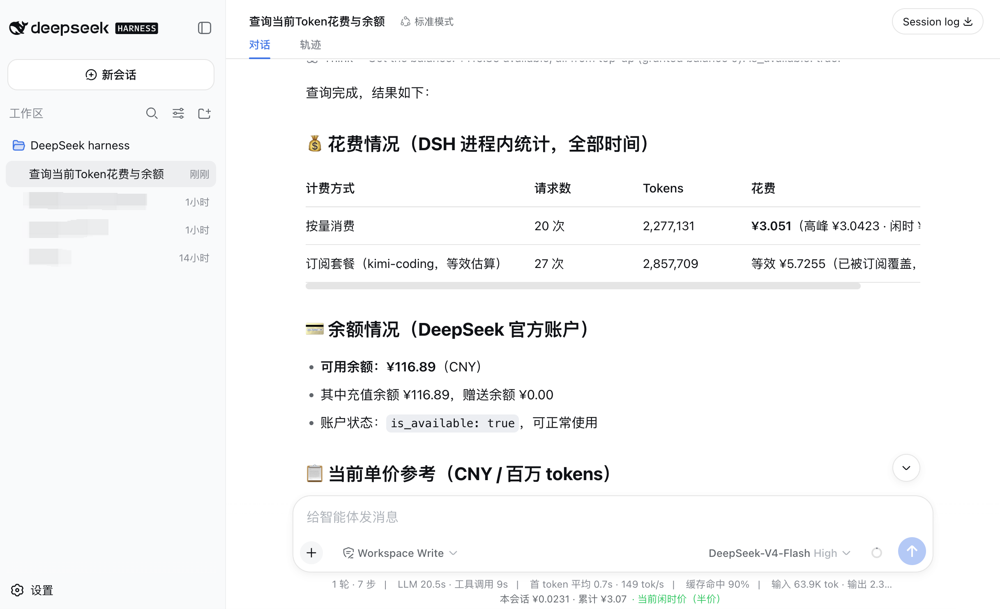
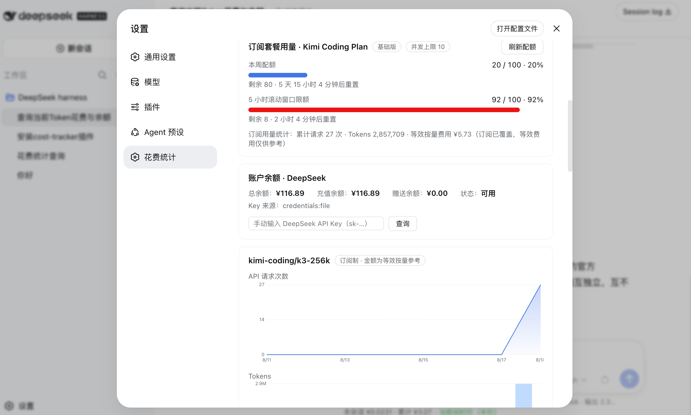
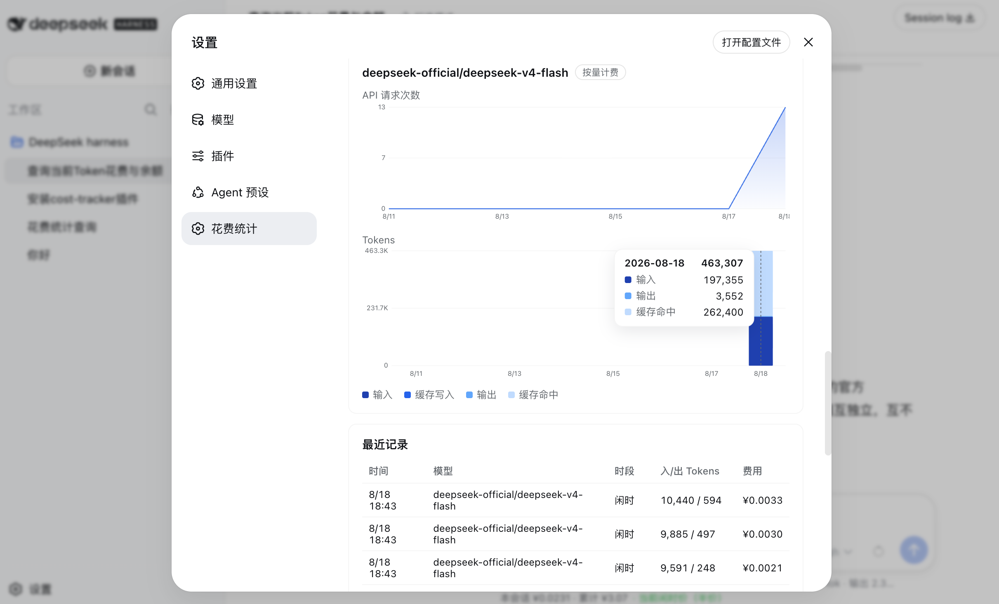

<div align="center">

#  DSH Cost Tracker · 花费统计

**DeepSeek Harness 的 LLM 用量与成本可视化插件**

[简体中文](./README.md) · [English](./README.en.md)

[](https://www.npmjs.com/package/@angelyeye/dsh-cost-tracker)


[](https://github.com/Angelyeye/dsh-cost-tracker/stargazers)

</div>

> 在 DSH 中自动记录每次 LLM 调用的 Token、费用和订阅用量，并通过看板、Agent 工具和可选的自建云同步，回答“我花了多少、为什么这样计费、哪台设备消耗最多”。

[快速安装](#快速开始) · [查看截图](#界面预览) · [查看更新记录](./CHANGELOG.md)

## 你会得到什么

| 能力 | 用途 |
| --- | --- |
| **自动记账** | 记录输入、输出、缓存和请求次数，按天、模型、设备与 Agent 聚合。 |
| **价格匹配** | 支持峰谷计价、订阅等效费用、官方价格同步和多厂商目录。 |
| **可视化看板** | 用概览卡、消费图表、模型明细和 Token 热力图快速定位成本。 |
| **订阅与余额** | 查看 Kimi Coding Plan、火山方舟 Coding Plan 等配额与账户余额。 |
| **Agent 与 API** | 在对话中直接查询花费、价格、峰谷状态、导入和同步状态，也可由本机 HTTP API 调用。 |
| **多机与隐私** | 默认保存到本机，可选同步到自建服务；令牌和密钥通常由 DSH 凭据机制托管。 |

## 界面预览

<table>
  <tr>
    <td width="50%"></td>
    <td width="50%"></td>
  </tr>
  <tr>
    <td></td>
    <td></td>
  </tr>
</table>

界面会随 DSH 宿主版本和插件版本变化，截图用于展示核心信息布局。

## 快速开始

前提是已经在使用 `dsh web`。插件声明的宿主兼容范围为 `dsh >= 0.1.0-rc.1`；如果当前宿主没有插件市场入口，可以使用折叠区中的手动安装方式。

### 1. 安装

```bash
dsh plugin --profile web add @angelyeye/dsh-cost-tracker
```

也可以在 DSH 的 **设置 → 插件市场** 搜索 `dsh-cost-tracker` 安装。

### 2. 重启并刷新

按提示重启 `dsh web`，然后刷新浏览器页面。

### 3. 验证

1. 打开 **设置 → 花费统计**，确认看板可见。
2. 确认聊天输入框下方出现花费状态条。
3. 在对话中询问“我今天花了多少钱？”，确认 Agent 能返回统计结果。

<details>
<summary>手动安装、开发链接与旧包迁移</summary>

手动安装：

```bash
mkdir -p ~/.dsh/profiles/node_modules/@angelyeye
git clone https://github.com/Angelyeye/dsh-cost-tracker.git ~/.dsh/profiles/node_modules/@angelyeye/dsh-cost-tracker
```

然后在 `~/.dsh/profiles/web/cordis.patch.yml` 的顶层数组追加：

```yaml
- insert:
    - id: dsh-cost-tracker
      name: "@angelyeye/dsh-cost-tracker"
```

重启：

```bash
dsh web
```

开发时使用官方链接方式，避免 profile 下次启动时重新安装旧包：

```bash
dsh plugin --profile web add link:/path/to/dsh-cost-tracker
```

从旧包名 `dsh-cost-tracker` 迁移时，先移除旧 loader 和旧目录，再安装 `@angelyeye/dsh-cost-tracker`。如果来源是 **v1.7.0**，请直接升级到 **v1.7.1 或更高版本**；重新安装 v1.7.0 不能修复当时的客户端注册缺陷。统计数据位于独立的存储文件中，安装方式变化不会自动删除数据。

</details>

## 工作原理

1. **捕获调用**：从 DSH 的 LLM 调用中读取模型、Token 和订阅信息。
2. **匹配价格**：按 provider、模型、时间段、订阅和自定义目录计算费用。
3. **保存与汇总**：默认写入本机记录并生成日汇总；启用云同步后，再以增量、幂等方式上报到自建服务。

## 常用操作

### 看板

进入 **设置 → 花费统计**，可以查看今日、本月、全时段费用、请求次数、Token、余额、按模型明细和 Token 热力图。看板支持 **本机 / 本机+云端 / 仅云端** 三种统计口径。

### 对话查询

插件提供以下 Agent 工具：

| 工具 | 示例问题 |
| --- | --- |
| `cost_stats` | “我今天花了多少钱？”“所有电脑加起来花了多少？” |
| `cost_prices` | “当前这个模型按什么价格计费？” |
| `cost_peak` | “现在是高峰还是闲时？” |
| `cost_recompute` | “按最新计费规则重新核对历史记录。” |
| `cost_import` | “把安装插件前的会话花费导入。” |
| `cost_sync` | “云端同步正常吗？现在立即同步。” |
| `cost_reset` | “清空全部统计数据。” |

### 导出

在配置页的 **数据与界面** 分组中导出 CSV，文件包含明细记录和日汇总行，可继续用 Excel 或 Numbers 分析。

## 数据与隐私

- 默认数据文件：`~/.dsh/storages/cost-tracker-records.json`。
- 可通过 `DSH_HOME` 或 `DSH_COST_TRACKER_STORE` 调整存储位置。
- 明细保留最近 180 天，更早数据折叠为永久日汇总，因此全时段统计仍可保持精确。
- 云同步是可选功能；启用后只上传统计所需的 Token、费用、时间戳和标识符，可选择会话脱敏。
- 云端令牌和火山 SecretAccessKey 通常写入 DSH 凭据库，配置文件只保存配置状态；旧宿主或凭据库不可写时，插件会兼容保留已有配置并提示。
- 本机 HTTP API 监听回环地址。不要把 DSH 服务端口直接暴露到公网。

<details>
<summary>高级配置：峰谷价格、订阅、云端与价格目录</summary>

配置入口为 **设置 → 花费统计 → 页头右上角齿轮**。

可配置内容包括：

- 峰谷时段条、切换提醒、系统通知和界面显示开关。
- Kimi Coding Plan、火山方舟 Coding Plan 等订阅配额。
- 自建云端地址、设备名、共享令牌、同步间隔、会话脱敏和默认视图。
- 官方定价页同步、多厂商价格目录、汇率、模型匹配模式和手动覆盖价。
- 历史导入、费用重算、数据清空和 CSV 导出。

`docs/provider-pricing.json` 保存随包分发的多厂商价格目录；价格和计费时代会持续变化，具体规则以配置页与 `cost_prices` 返回为准。

</details>

<details>
<summary>HTTP API</summary>

接口均为本机 `POST` + JSON，常用端点如下：

```text
/api/cost-tracker/summary
/api/cost-tracker/dashboard
/api/cost-tracker/usage
/api/cost-tracker/peak
/api/cost-tracker/sync
/api/cost-tracker/sync-now
/api/cost-tracker/sync-test
/api/cost-tracker/cloud
/api/cost-tracker/balance
/api/cost-tracker/prices
/api/cost-tracker/recompute
/api/cost-tracker/import-status
/api/cost-tracker/import-run
/api/cost-tracker/export
```

示例：

```bash
curl -X POST http://127.0.0.1:3080/api/cost-tracker/summary -d '{}'
```

上面的 `3080` 只是示例端口，请替换为当前 `dsh web` 实例实际监听的端口。

</details>

<details>
<summary>多机汇总</summary>

多机汇总使用独立的自建 [`dsh-cost-cloud`](https://github.com/Angelyeye/dsh-cost-cloud) 服务，协议说明见其 [`INGEST-API.md`](https://github.com/Angelyeye/dsh-cost-cloud/blob/main/docs/INGEST-API.md)。插件本身不依赖云端即可完成本机统计；配置云端后，多个设备可以查看本机、本机加云端或仅云端的聚合结果，并按设备和 Agent 拆分。

配置路径：**设置 → 花费统计 → 页头右上角齿轮 → 多机汇总（云端同步）**。

</details>

## 常见问题

<details>
<summary>重启 DSH 会丢数据吗？</summary>

不会。记录会写入本机文件并在重启后恢复；Windows 上遇到短暂文件占用时会自动重试。若持续失败，请确认没有同时运行多个 DSH 实例。

</details>

<details>
<summary>订阅的“等效费用”是真实扣费吗？</summary>

不是。它表示如果这些调用按量计费，大约对应多少费用，用于评估订阅价值；真实账单仍以服务商为准。

</details>

<details>
<summary>为什么金额和官方账单可能不同？</summary>

插件按本地价格目录和记录时间估算，官方调价、阶梯价格或账单口径变化都可能造成差异。精确金额请以官方账单为准。

</details>

<details>
<summary>如何卸载或更新？</summary>

市场安装：在 **设置 → 插件市场** 操作卸载或更新。手动安装：移除 `cordis.patch.yml` 中的 loader 条目，再删除插件目录。更新界面代码后通常需要硬刷新浏览器，更新宿主代码后需要重启 `dsh web`。

</details>

## 开发

```bash
npm install
npm test
```

测试覆盖存储、计价、订阅、云同步、导入、配置和客户端渲染等模块。

## 相关文件

- [`CHANGELOG.md`](./CHANGELOG.md)：完整版本记录。
- [`docs/provider-pricing.json`](./docs/provider-pricing.json)：随包分发的多厂商价格目录。
- [`docs/THIRD-PARTY-NOTICES.md`](./docs/THIRD-PARTY-NOTICES.md)：第三方成果与数据来源。
- [`package.json`](./package.json)：插件清单、宿主兼容范围和脚本。

## License

[MIT](./LICENSE)
